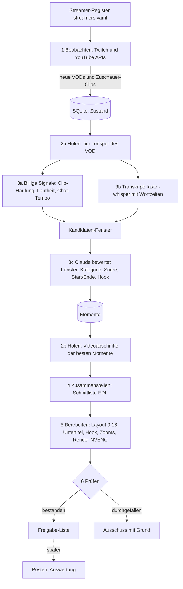

# GTA6 Clip-Engine: Masterplan

## Kurzfassung

Die Engine beobachtet eine Liste von GTA-Streamern. Sie holt deren neue
Streams, Videos und Zuschauer-Clips, findet darin automatisch die stärksten
Momente, schneidet sie zu fertigen Hochformat-Videos zusammen und setzt
Untertitel, Hook und Effekte dazu. Am Ende liegt ein fertiges Video in einer
Freigabe-Liste. Posten, Auswertung und Monetarisierung kommen in einem
späteren Plan (Owner, 2026-11-17).

Sie läuft als Python-Programm auf dem Laptop und startet sich über die
Windows-Aufgabenplanung selbst. Gemessen am 2026-11-17: RTX 3060 Laptop mit
6 GB, Ryzen 7 5800H mit 16 Threads, 15 GB RAM, 529 GB frei, ffmpeg 8.1
installiert, yt-dlp noch nicht.

Ein Durchlauf hat sieben Stufen:

1. **Beobachten:** neue Streams, Videos und Zuschauer-Clips der Streamer-Liste finden.
2. **Holen:** zuerst nur die Tonspur, danach nur die Abschnitte, die zählen. Nie ganze Streams in Video.
3. **Analysieren:** Momente finden und bewerten.
4. **Zusammenstellen:** Momente zu einem Video anordnen, als Einzelclip oder Zusammenschnitt.
5. **Bearbeiten:** Hochformat, Untertitel, Hook, Zooms, Lautstärke, Rendern.
6. **Prüfen:** automatische Checks, danach die Freigabe-Liste.
7. **Betrieb:** Zeitplan, Wiederanlauf, Aufräumen, Speicherwächter.

## Ablauf

## Phasen

| Phase | Name | Inhalt | Hängt ab von | Stand |
|---|---|---|---|---|
| p1.1 | Fundament + Beobachten | uv-Projekt, SQLite-Schema, Streamer-Register, Twitch/YouTube-Abfrage | Owner: Twitch-App, Streamer-Liste | spec |
| p1.2 | Holen | Tonspur-Download, Abschnitts-Download, Zuschauer-Clips, Ablage, Aufräumen | p1.1 | spec |
| p1.3 | Analysieren | Signale, Transkript, Claude-Bewertung, Momente-Tabelle | p1.2 | spec |
| p1.4 | Zusammenstellen | Formate, Auswahlregeln, Schnittliste | p1.3 | spec |
| p1.5 | Bearbeiten + Rendern | Layout-Profile, Untertitel, Hook, Effekte, Lautheit, NVENC | p1.4 | spec |
| p1.6 | Prüfen | automatische Checks, Freigabe-Liste | p1.5 | spec |
| p1.7 | Betrieb | Zeitplan, Wiederanlauf, Logs, Speicherwächter | p1.1 bis p1.6 | spec |

Reihenfolge beim Bauen: p1.1 bis p1.3 zuerst, an einem echten Stream von Hand
angestoßen. Dann p1.4 bis p1.6 für ein erstes fertiges Video. p1.7 erst, wenn
ein Durchlauf von Hand sauber läuft.

## Stufe für Stufe

### 1. Beobachten (p1.1)

**Streamer-Register** `engine/config/streamers.yaml`, eine Zeile pro Streamer:
Anzeigename, Twitch-Login, YouTube-Kanal-ID (optional), Sprache,
Layout-Profil (siehe Stufe 5), Priorität, `permission` (`unknown`, `yes`,
`no`). Das Erlaubnis-Feld bleibt vorerst auf `unknown`; die Regel dazu kommt
mit dem Posten-Plan.

**Twitch** (App-Access-Token per Client-Credentials; laut Twitch-Doku reicht
jedes gültige Token zum Lesen von Clips):

- Login → `broadcaster_id` über Get Users.
- Neue Stream-Aufzeichnungen über Get Videos (`type=archive`).
- Zuschauer-Clips über Get Clips mit `broadcaster_id` und `started_at`/`ended_at`.
  Laut Doku kommen sie nach Aufrufen absteigend sortiert, und jeder Clip trägt
  `video_id` und `vod_offset`: den Abstand in Sekunden vom Anfang der
  Aufzeichnung bis zum Clip-Start. Damit lässt sich jeder Zuschauer-Clip auf
  seine Stelle im Stream legen. Ist die Aufzeichnung gelöscht, ist `vod_offset`
  leer.
- Entdecken neuer Streamer: Get Clips mit der `game_id` von GTA VI (über Search
  Categories ermitteln). Neue Namen landen als Vorschlag in einer Liste, nie
  automatisch im Register.

**YouTube** (Data API, allgemeiner Kontingent-Topf): neue Uploads über die
Uploads-Playlist des Kanals.

**Kick:** offen, im Plan nicht enthalten. UNVERIFIED, ob eine Clip-Schnittstelle
existiert.

**Ergebnis:** neue Zeilen in `videos` und `crowd_clips` mit Status `new`.

### 2. Holen (p1.2)

Zwei Durchgänge, damit nie ganze Streams in Video geladen werden:

1. **Tonspur** des ganzen VOD (yt-dlp, Audio-Format). Reicht für Transkript,
   Lautheit und die Bewertung.
2. **Videoabschnitte** erst nach der Analyse, nur für die besten Momente, mit
   `yt-dlp --download-sections "*START-ENDE"` (laut yt-dlp-README: Download
   nur eines Zeitbereichs), mit 5 s Puffer vor und nach dem Moment. In
   höchster verfügbarer Qualität.

**Zuschauer-Clips** werden direkt geladen. Eine offizielle Download-Schnittstelle
gibt es nicht (Twitch-Doku); yt-dlp unterstützt Twitch-Clips nach allgemeinem
Kenntnisstand, im Prototyp prüfen.

**Ablage** (gitignored): `engine/data/{streamer}/{video_id}/` mit `audio.m4a`,
`sections/`, `crowd/`. Rohdaten werden nach dem Rendern und N Tagen gelöscht.
Zur Größenordnung: ein 1080p-Stream mit 6 Mbit/s wären 2,7 GB pro Stunde.
Deshalb wird nur in Abschnitten geladen.

**Offen, im Prototyp prüfen:** abonnentenpflichtige VODs, stummgeschaltete
Abschnitte (Musik-Takedowns), Verhalten von yt-dlp bei sehr langen VODs.

### 3. Analysieren (p1.3)

**a) Billige Signale** (kostenlos, für den ganzen Stream):

- **Clip-Häufung:** viele Zuschauer-Clips nah beieinander, gewichtet nach
  Aufrufen. Das ist das stärkste Signal, denn Zuschauer haben die Stelle
  bereits selbst ausgewählt.
- **Lautheit:** Spitzen im Ton (Schreien, Lachen) über ffmpeg, relativ zum
  Durchschnitt des Streamers.
- **Chat-Tempo:** Nachrichten pro 10 s und Emote-Art (Lachen gegen Hype).
  Twitch bietet keine offizielle Chat-Wiederholung über die API. Das
  inoffizielle Werkzeug TwitchDownloaderCLI ist eine Option. Optional,
  UNVERIFIED.

**b) Transkript:** faster-whisper (large-v3, int8) auf der GPU, mit
Wortzeitstempeln und der Sprache aus dem Register. Ob 6 GB VRAM und die
Laufzeit reichen, wird im Prototyp gemessen.

**c) Bewertung durch Claude:** Kandidaten-Fenster aus a) und Transkript,
jeweils etwa ±60 s. Pro Fenster liefert Claude über strukturierte Ausgabe
(JSON-Schema):

- Kategorie: lustig, Chaos, Können, Entdeckung, Fail, Ausraster, Story
- Score von 0 bis 10 mit einem Satz Begründung
- Start und Ende an Satzgrenzen
- Spoiler-Verdacht (Story-Zwischensequenz)
- zwei bis drei Hook-Vorschläge

**Modell:** Standard ist Claude Opus 5.5 (`claude-opus-5-5`, 4 $ / 20 $ pro
Million Tokens Ein-/Ausgabe). Claude Haiku 5.5 (`claude-haiku-5-5`, 0,10 $ /
0,50 $) ist die günstige Option für die Massenbewertung. Die Wahl trifft der
Owner nach einem Vergleich beider Modelle auf denselben echten Streams. Die
Bewertung ist nicht eilig, deshalb läuft sie über die Batch-Schnittstelle
(halber Preis).

**Kostenschätzung** (Annahme 150 gesprochene Wörter pro Minute, also etwa
12.000 Tokens Transkript pro Stream-Stunde; im Prototyp messen): mit Opus 5.5
etwa 0,10 bis 0,40 $ pro Stream-Stunde, mit Haiku 5.5 etwa 1 Cent. Die
Batch-Schnittstelle halbiert beides.

**d) Bild (optional, nur Kandidaten):** Einzelbilder des Moments an Claude
(Vision), um Zwischensequenzen und reine Menü- oder Ladebildschirme zu
erkennen.

**Ergebnis:** Tabelle `moments` mit Quelle, Start, Ende, Kategorie, Score,
Signalen, Spoiler-Flag und Hook-Vorschlägen.

### 4. Zusammenstellen (p1.4)

**Formate:**

- **F1 Einzelmoment** (15 bis 60 s): ein starker Moment, Hook vorne.
- **F2 Zusammenschnitt** (über 60 s): drei bis sechs Momente zu einem Thema,
  zum Beispiel ein Streamer an einem Tag, eine Kategorie über mehrere Streamer
  oder „die größten Fails gestern“.

**Auswahlregeln:** Momente mit Score ab einer Schwelle (nach dem ersten
Durchlauf festlegen), keine Spoiler-Momente, jeder Moment höchstens einmal pro
Format. Reihenfolge im Zusammenschnitt: kurzer Anriss des stärksten Augenblicks
in den ersten ein bis zwei Sekunden, danach Aufbau, das Beste zum Schluss. Diese
Reihenfolge ist eine Annahme und wird später an Zahlen getestet.

**Ergebnis:** eine Schnittliste (EDL, JSON) pro Video: Segmente mit Quelle,
Ein- und Ausstieg, Untertitel-Wörtern, Overlays und Stil-Set. Die Schnittliste
ist die einzige Eingabe für Stufe 5. So lässt sich jedes Video neu rendern,
ohne neu zu analysieren.

### 5. Bearbeiten und Rendern (p1.5)

- **Layout 1080×1920.** Pro Streamer ein Layout-Profil mit dem
  Facecam-Rechteck, einmal festgelegt über ein Kalibrier-Skript, das ein
  Standbild zeigt. Gesichtserkennung dient nur als Ersatz, wenn ein Profil
  fehlt. Varianten: Facecam oben (1/3) und Gameplay unten (2/3), nur Gameplay
  vor unscharfem Hintergrund, oder geteiltes Bild.
- **Untertitel** aus den Whisper-Wortzeiten, im ASS-Format über ffmpeg/libass
  eingebrannt. Zwei bis vier Wörter pro Zeile, das gesprochene Wort ist
  hervorgehoben, Füllwörter fallen weg. Sprache wie der Streamer.
- **Hook:** Textzeile oben in den ersten etwa drei Sekunden, aus den
  Vorschlägen der Stufe 3. Varianten werden gespeichert.
- **Effekte:** Zoom auf Lautheit-Spitzen, Name des Streamers als Einblendung,
  optional ein Fortschrittsbalken. Musik und Soundeffekte gehören nicht zu
  dieser Phase (Rechte offen).
- **Lautheit** auf etwa -14 LUFS normalisieren (ffmpeg `loudnorm`).
- **Rendern** mit ffmpeg `h264_nvenc` auf der RTX 3060, 30 oder 60 fps.
- **Abwechslung statt Schablone:** Stil-Sets (Schrift, Farben, Layout,
  Hook-Formulierung) wechseln von Video zu Video. Die Schnittliste hält fest,
  welches Set benutzt wurde. Das wirkt dem Schablonen-Muster entgegen, das
  YouTube nicht monetarisiert (siehe [README](../../README.md)).

Werkzeug: Python baut aus der Schnittliste die ffmpeg-Filterkette. Remotion
(React-Video) bleibt eine Option für aufwendigere Grafiken.

### 6. Prüfen (p1.6)

**Automatische Checks**, jedes Video muss alle bestehen:

- Format: 1080×1920, Dauer im Formatrahmen, fps
- Ton: Lautheit -14 ±1 LUFS, keine Stille über 2 s
- Bild: keine schwarzen oder eingefrorenen Strecken (ffmpeg `blackdetect` / `freezedetect`)
- Untertitel: Stichprobe der Wortzeiten gegen das Audio
- Inhalt: kein Spoiler-Flag
- Duplikat: Wahrnehmungs-Hash gegen alle früheren Renders
- Stumme Twitch-Abschnitte: dürfen nicht im Video landen

**Freigabe-Liste:** bestandene Videos landen in `engine/data/ready/` mit einer
kleinen lokalen Übersichtsseite (Vorschau, Hook, Quelle, Score). Abgelehnte
landen mit Grund in `rejected/`. Die Freigabe erfolgt bis auf Weiteres von
Hand; das Posten kommt später.

### 7. Betrieb (p1.7)

- **CLI:** `uv run clipengine watch | fetch | analyze | compose | render | check`, plus `run` für alles.
- **Zustand** in SQLite. Jeder Datensatz durchläuft
  `new → fetched → analyzed → composed → rendered → checked`. Jede Stufe ist
  idempotent: Ein Abbruch setzt beim nächsten Lauf an derselben Stelle fort.
- **Zeitplan** über die Windows-Aufgabenplanung: Beobachten alle 30 Minuten,
  schwere Arbeit (Transkript, Rendern) gebündelt. Läuft nur bei
  eingeschaltetem Laptop; Energiesparmodus während Läufen verhindern.
- **Speicherwächter:** Unter 50 GB frei stoppen neue Downloads. Rohdaten werden
  nach Plan gelöscht.
- **Geheimnisse** (Twitch-Client-ID und -Secret, Anthropic-Key) in
  `workspace/projects/gta6-clipping/context/.env` (gitignored).
- **Logs** pro Lauf. Fehler pro Datensatz werden mit Zähler gespeichert; nach
  drei Fehlschlägen fällt der Datensatz aus der Warteschlange und erscheint
  im Bericht.

## Datenmodell (SQLite)

| Tabelle | Inhalt |
|---|---|
| `streamers` | Spiegel des Registers |
| `videos` | VODs und Uploads: Quelle, ID, Länge, Datum, Status |
| `crowd_clips` | Zuschauer-Clips: ID, `video_id`, `vod_offset`, Dauer, Aufrufe |
| `signals` | Zeitreihen pro Video: Lautheit, Chat-Tempo, Clip-Dichte |
| `transcripts` | Wörter mit Zeitstempel pro Video |
| `moments` | bewertete Momente (Stufe 3) |
| `compositions` | Schnittlisten (Stufe 4), Format, Stil-Set |
| `renders` | Ausgabedateien, Prüfergebnisse, Status |

## Ort im Repo

- Code: `workspace/projects/gta6-clipping/engine/` als eigenes uv-Projekt
  (CLAUDE.md: jeder Dienst ist ein eigenes uv-Projekt)
- Daten: `engine/data/` (gitignored)
- Geheimnisse: `context/.env` (gitignored)

## Randfälle

| Fall | Umgang |
|---|---|
| VOD gelöscht oder nur für Abonnenten | Zuschauer-Clips bleiben nutzbar (`vod_offset` leer); Video überspringen und vermerken |
| Stummgeschaltete Abschnitte | aus Kandidaten ausschließen |
| Streamer ändert Overlay | Facecam-Check pro Render gegen das Profil; Abweichung → Profil neu kalibrieren |
| Whisper erfindet Text in Musik oder Stille | Lautheit- und Sprach-Wahrscheinlichkeit prüfen, solche Fenster verwerfen |
| yt-dlp bricht nach Seitenänderung | yt-dlp regelmäßig aktualisieren; Fehler landet im Bericht |
| Twitch-Ratenlimit | Abfragen drosseln, bei 429 warten und wiederholen |
| Platte voll | Speicherwächter (Stufe 7) |
| Laptop schläft mitten im Lauf | idempotente Stufen setzen beim nächsten Start fort |

## Erfolgskriterien

- [ ] p1.1: Für drei Streamer listet die Engine die neuen VODs und Zuschauer-Clips der letzten sieben Tage, abgeglichen mit der Twitch-Seite.
- [ ] p1.3: Trefferquote auf einem echten Stream von mindestens zwei Stunden: Wie viele der zehn meistgesehenen Zuschauer-Clips liegen unter den 20 besten Momenten der Engine? Den Zielwert legen wir nach dem ersten Messlauf fest.
- [ ] p1.5: Das fertige Video hat 1080×1920, Lautheit -14 ±1 LUFS, und die Untertitel weichen in der Stichprobe weniger als 0,2 s vom Ton ab.
- [ ] Ende-zu-Ende: Aus einem neuen Stream entsteht ohne Handgriff mindestens ein fertiges Video in der Freigabe-Liste.

## Was der Owner zum Start liefert

1. **Twitch-Developer-App** auf dev.twitch.tv mit dem eigenen Twitch-Account
   anlegen; Client-ID und Secret kommen in `context/.env`. Dafür braucht es
   den Login des Owners.
2. **Start-Liste mit 5 bis 10 GTA-Streamern** (Twitch-Login, Sprache).
3. **Anthropic-API-Zugang** für die Bewertung (Key oder `ant auth login`).

## Später (nicht Teil dieses Plans)

Posten und Accounts, Erlaubnis der Streamer (das Register-Feld ist
vorbereitet), Monetarisierung, Auswertung und Lernschleife, Musik und
Soundeffekte, Übersetzung und Sprachwahl, Kick, Betrieb außerhalb des Laptops.

## Referenz

- [Projekt-README](../../README.md): Plattformregeln, Monetarisierung, Quellen
- [Status](../../status/p1-clip-pipeline.md)
- [Twitch API: Clips](https://dev.twitch.tv/docs/api/clips/)
- [yt-dlp README](https://github.com/yt-dlp/yt-dlp/blob/master/README.md)
