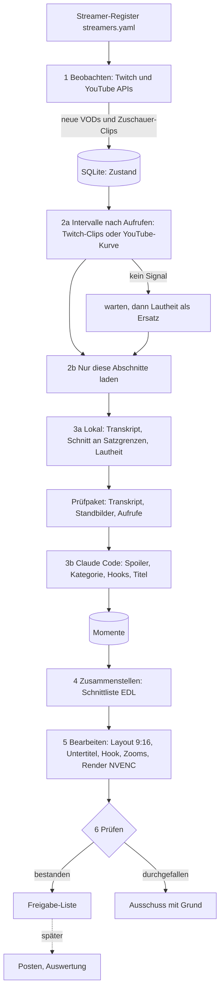

# GTA6 Clip-Engine: Masterplan

## Kurzfassung

Die Engine beobachtet eine Liste von GTA-Streamern. Sie holt deren neue
Streams, Videos und Zuschauer-Clips, findet darin automatisch die stärksten
Momente, schneidet sie zu fertigen Hochformat-Videos zusammen und setzt
Untertitel, Hook und Effekte dazu. Am Ende liegt ein fertiges Video in einer
Freigabe-Liste. Posten, Auswertung und Monetarisierung kommen in einem
späteren Plan (Owner, 2026-11-17).

Sie läuft als Python-Programm auf dem Laptop und startet sich über die
Windows-Aufgabenplanung selbst. Gemessen am 2026-11-17: RTX 3060 Laptop mit
6 GB, Ryzen 7 5800H mit 16 Threads, 15 GB RAM, 529 GB frei, ffmpeg 8.1
installiert, yt-dlp noch nicht.

Ein Durchlauf hat sieben Stufen:

1. **Beobachten:** neue Streams, Videos und Zuschauer-Clips der Streamer-Liste finden.
2. **Holen:** nur die meistgesehenen Stellen laden, bei Twitch über die Zuschauer-Clips, bei YouTube über die Kurve „Meistgesehene Stellen“. Nie ganze Streams.
3. **Analysieren:** Rangfolge nach Aufrufen, Transkript und Schnitt lokal; Spoiler-Check, Hooks und Titel macht Claude Code. Keine API-Kosten.
4. **Zusammenstellen:** Momente zu einem Video anordnen, als Einzelclip oder Zusammenschnitt.
5. **Bearbeiten:** Hochformat, Untertitel, Hook, Zooms, Lautstärke, Rendern.
6. **Prüfen:** automatische Checks, danach die Freigabe-Liste.
7. **Betrieb:** Zeitplan, Wiederanlauf, Aufräumen, Speicherwächter.

## Ablauf

## Phasen

| Phase | Name | Inhalt | Hängt ab von | Stand |
|---|---|---|---|---|
| p1.1 | Fundament + Beobachten | uv-Projekt, SQLite-Schema, Streamer-Register, Twitch/YouTube-Abfrage, Streamer-Vorschläge | Owner: Twitch-App, Streamer-Liste | gebaut 2026-11-17 |
| p1.2 | Holen | Intervalle nach Aufrufen (Clips, YouTube-Kurve), Abschnitts-Download, Ablage, Aufräumen | p1.1 | Twitch gebaut 2026-11-19; YouTube-Kurve offen |
| p1.3 | Analysieren | Transkript und Schnitt lokal, Prüfpakete, Urteil durch Claude Code, Momente-Tabelle | p1.2 | gebaut 2026-11-19; `claude -p` offen |
| p1.4 | Zusammenstellen | Formate, Auswahlregeln, Schnittliste | p1.3 | spec |
| p1.5 | Bearbeiten + Rendern | Layout-Profile, Untertitel, Hook, Effekte, Lautheit, NVENC | p1.4 | spec |
| p1.6 | Prüfen | automatische Checks, Freigabe-Liste | p1.5 | spec |
| p1.7 | Betrieb | Zeitplan, Wiederanlauf, Logs, Speicherwächter | p1.1 bis p1.6 | spec |

Reihenfolge beim Bauen: p1.1 bis p1.3 zuerst, an einem echten Stream von Hand
angestoßen. Dann p1.4 bis p1.6 für ein erstes fertiges Video. p1.7 erst, wenn
ein Durchlauf von Hand sauber läuft.

## Stufe für Stufe

### 1. Beobachten (p1.1)

**Streamer-Register** `engine/config/streamers.yaml`, eine Zeile pro Streamer:
Anzeigename, Twitch-Login, YouTube-Kanal-ID (optional), Sprache,
Layout-Profil (siehe Stufe 5), Priorität, `permission` (`unknown`, `yes`,
`no`). Das Erlaubnis-Feld bleibt vorerst auf `unknown`; die Regel dazu kommt
mit dem Posten-Plan.

**Twitch** (App-Access-Token per Client-Credentials; laut Twitch-Doku reicht
jedes gültige Token zum Lesen von Clips):

- Login → `broadcaster_id` über Get Users.
- Neue Stream-Aufzeichnungen über Get Videos (`type=archive`). Eine Aufzeichnung
  zählt, wenn irgendein Teil davon im Fenster liegt, nicht nur ihr Anfang
  (KaiCenats 35-Stunden-Marathon begann vor dem Fenster und trägt 1.772 Clips
  darin). Get Videos liefert auch `muted_segments`, gespeichert für p1.2.
- Zuschauer-Clips über Get Clips mit `broadcaster_id` und `started_at`/`ended_at`.
  Sie kommen nach Aufrufen absteigend sortiert (live geprüft), und jeder Clip
  trägt `video_id` und `vod_offset`: den Abstand in Sekunden vom Anfang der
  Aufzeichnung bis zum Clip-Start. Damit lässt sich jeder Zuschauer-Clip auf
  seine Stelle im Stream legen. Ist die Aufzeichnung gelöscht, ist `vod_offset`
  leer. Jede Abfrage bricht bei etwa 1.000 Treffern ab und liefert dabei
  Doppelte; die Engine fragt deshalb in 6-Stunden-Stücken ab. Gemessen am
  2026-11-17 an KaiCenat über 7 Tage: eine Abfrage etwa 800 verschiedene Clips,
  in Stücken 1.914. Ein zweiter Lauf fand noch 426 weitere, alle mit höchstens
  2 Aufrufen; die 300 meistgesehenen hatte schon der erste Lauf. Jeder Lauf
  liest das ganze Fenster neu, damit Aufrufe aktuell bleiben.
- Entdecken neuer Streamer (`clipengine suggest`): Get Clips mit der `game_id`
  von GTA VI (`1867279146`, geprüft 2026-11-17), in denselben Stücken, nur
  Clips in der gewählten Sprache. Rangfolge nach der Summe der Clip-Aufrufe
  pro Streamer; dazu Clip-Zahl, Zahl der verschiedenen Clipper, Follower,
  Partner/Affiliate und Warnhinweise (klippt sich überwiegend selbst, weniger
  als drei Clipper, andere Kanalsprache). Neue Namen landen als Vorschlag in
  einer Liste, nie automatisch im Register; `clipengine approve` trägt nach
  dem Ja des Owners ein, `clipengine reject` hält einen Namen dauerhaft fern.

**YouTube:** neue Uploads über den öffentlichen Kanal-Feed
(`youtube.com/feeds/videos.xml?channel_id=...`): ohne API-Key und ohne
Kontingent, die letzten 15 Uploads mit Datum (geprüft 2026-11-17). Für die
Data API gibt es keinen Key; Länge und Kurve holt ohnehin yt-dlp in p1.2.

**Kick:** offen, im Plan nicht enthalten. UNVERIFIED, ob eine Clip-Schnittstelle
existiert.

**Ergebnis:** neue Zeilen in `videos` und `crowd_clips` mit Status `new`.

### 2. Holen (p1.2)

**Grundsatz (Owner, 2026-11-17):** Wo erkennbar ist, welche Stellen eines
Videos am meisten gesehen wurden, zählen nur diese Stellen. Geladen werden nur
diese Intervalle, nie ein ganzer Stream.

**Woher die Aufrufe kommen:**

- **Twitch-Streams:** aus den Zuschauer-Clips. Jeder Clip hat Aufrufe
  (`view_count`), Startsekunde im Stream (`vod_offset`) und Länge; daraus
  ergibt sich sein Intervall. Überlappende Clips werden zu einem Intervall
  verschmolzen, dessen Gewicht die Summe ihrer Aufrufe ist.
- **YouTube-Videos:** aus der Kurve „Meistgesehene Stellen“. yt-dlp liefert
  sie als Feld `heatmap` mit 100 Abschnitten, jeder mit einem Wert von 0 bis 1,
  ohne das Video zu laden (geprüft 2026-11-17 mit yt-dlp 2026.10.26). Der
  Videoanfang ist fast immer am höchsten, weil dort jeder startet; die ersten
  Abschnitte zählen deshalb nicht. Ein Intervall ist eine zusammenhängende
  Spitze deutlich über dem Median der Kurve.
- **Kein Aufruf-Signal** (frischer Stream ohne Clips, Video ohne Kurve): Das
  Video wartet, weil Clips und Kurve erst mit der Zeit entstehen. Bleibt es
  leer, greift als Ersatz die Lautheit der Tonspur. Wartezeit und Ersatz sind
  Annahmen und einstellbar.

**Schritte:**

1. Intervalle bestimmen, nur aus Metadaten (Twitch-API, `yt-dlp -j --skip-download`).
2. Die stärksten N nach Gewicht wählen; N und Mindest-Aufrufe sind einstellbar.
3. Nur diese Abschnitte laden, mit 5 s Puffer davor und danach, in höchster
   verfügbarer Qualität: `yt-dlp --download-sections "*START-ENDE"` (laut
   yt-dlp-README: Download nur eines Zeitbereichs).
4. Von Zuschauer-Clips zählen nur die Zeitangaben; geschnitten wird aus dem
   VOD in voller Qualität. Ist das VOD weg (gelöscht, nur für Abonnenten),
   wird der Clip selbst geladen: Clips ohne VOD, die innerhalb von 90 s
   entstanden, gelten als ein Moment, geladen wird dessen meistgesehener Clip.

**Gebaut 2026-11-19 (`clipengine fetch`), live geprüft:**

- **`vod_offset` ist das Ende des Clips, nicht der Anfang**, anders als die
  Twitch-Doku sagt. Gemessen über den Ton: drei Clips (6,4 / 17,6 / 33,7 s
  lang, zwei VODs) per Kreuzkorrelation im VOD gesucht; jeder beginnt bei
  `vod_offset - Dauer`, auf etwa 1 s genau.
- yt-dlp 2026.10.26 lädt Abschnitte aus Twitch-VODs sauber, auch aus der
  23. Stunde eines 23-Stunden-VODs: 44 s in 1080p60 in etwa 7 s.
- yt-dlp lädt Twitch-Clips (auch als „portrait“-Varianten, die die Engine
  meidet).
- Über IPv6 bricht die Leitung des Laptops rund 40 % der ersten Anfragen ab
  (WinError 10054, bei Twitch wie bei Hugging Face), über IPv4 keine von 15.
  yt-dlp läuft deshalb mit `--force-ipv4`, jeder Download wird trotzdem bis
  zu dreimal versucht.
- Lange Ketten überlappender Clips (bis 120 Clips an einem Moment) werden auf
  120 s um den meistgesehenen Clip gekürzt.
- Eine Aufzeichnung, deren Streamer noch live ist, wird übersprungen.

**Ablage** (gitignored): `engine/data/{streamer}/{video_id}/sections/` und
`engine/data/{streamer}/clips/`. Rohdaten werden nach dem Rendern und N Tagen
gelöscht (p1.7).

**Offen:** stummgeschaltete Abschnitte sind ausgeschlossen, aber an keinem der
ersten VODs vorgekommen; die YouTube-Kurve folgt nach dem ersten Video.

### 3. Analysieren (p1.3)

**Ohne API-Kosten (Owner, 2026-11-17):** Rechnen macht der Laptop, Urteilen
macht Claude Code über das vorhandene Abo. Es gibt keinen Anthropic-API-Key
und keine Kosten pro Aufruf.

**Rechnerisch, lokal:**

- **Rangfolge** der Intervalle nach Aufrufen (aus Stufe 2).
- **Transkript** nur für die geladenen Abschnitte: faster-whisper (large-v3,
  int8) auf der GPU, mit Wortzeiten und der Sprache aus dem Register. Ob 6 GB
  VRAM und die Laufzeit reichen, misst der Prototyp.
- **Schnitt an Satzgrenzen:** Start und Ende auf Wortzeiten und Pausen
  ausrichten, damit kein Satz abgeschnitten wird.
- **Lautheit-Spitzen** (ffmpeg `ebur128`) für die Zooms in Stufe 5.

**Urteil, Claude Code:** Pro gewähltem Moment schreibt die Engine ein
Prüfpaket nach `engine/data/review/{moment}/`: Transkript, 6 bis 8
Standbilder, Aufrufe, Streamer. Claude Code liest die Pakete und schreibt pro
Moment zurück:

- Spoiler oder Zwischensequenz ja/nein, anhand der Standbilder
- Kategorie und Thema (lustig, Chaos, Können, Entdeckung, Fail, Ausraster, Story)
- zwei bis drei Hooks und einen Titel
- „verwerfen“, wenn der Moment ohne Kontext nicht funktioniert
- Ab-18-Risiko: drastische Gewalt oder sexuelle Inhalte (Strip-Club) verwerfen
  oder entschärfen. YouTube stuft drastische Spielgewalt seit den Regeln vor
  GTA 6 ab 18 ein, wenn sie nicht unkenntlich ist; ab 18 sehen nur angemeldete
  Volljährige das Video (PC Gamer, Dexerto, 2026-09; YouTube-Hilfe
  „Altersbeschränkte Inhalte“).

Claude Code läuft auf zwei Wegen: im Gespräch („arbeite die Prüfpakete ab“)
oder automatisch per Windows-Aufgabenplanung mit `claude -p`. Beide zählen
gegen die Nutzungsgrenzen des Abos. Deshalb bekommt Claude Code nur die schon
nach Aufrufen gewählten Momente, nie ganze Streams. Ist die Grenze erreicht,
warten die Pakete bis zum nächsten Lauf. `claude` 2.1.212 ist auf dem Laptop
installiert (geprüft 2026-11-17).

**Ergebnis:** Tabelle `moments` mit Quelle, Intervall, Aufrufen, Kategorie,
Spoiler-Flag, Hooks und Titel.

**Gebaut 2026-11-19 (`clipengine analyze` / `judge`), live gemessen:** 21
Abschnitte in 3 min 19 s; Whisper large-v3 (int8_float16) braucht für 120 s
Ton 4 bis 8 s (bis 32 s bei Musik), Spitze 2,5 von 6 GB VRAM. Erstes Urteil:
2 behalten (ohnePixel Jet-Absturz, caseoh_ Rollstuhl-Verfolgung), 6 verworfen
(Strip-Club, vier Story-Zwischensequenzen, ein Radio-Song), 13 offen. Die
Hälfte der meistgesehenen Momente am Launch-Tag waren Zwischensequenzen; der
Spoiler-Check ist also kein Randfall.

### 4. Zusammenstellen (p1.4)

**Formate:**

- **F1 Einzelmoment** (15 bis 60 s): ein starker Moment, Hook vorne.
- **F2 Zusammenschnitt** (über 60 s): drei bis sechs Momente zu einem Thema,
  zum Beispiel ein Streamer an einem Tag, eine Kategorie über mehrere Streamer
  oder „die größten Fails gestern“.

**Auswahlregeln:** Momente in der Rangfolge ihrer Aufrufe, keine Spoiler,
nichts, was Claude Code verworfen hat, jeder Moment höchstens einmal pro
Format. Reihenfolge im Zusammenschnitt: kurzer Anriss des stärksten Augenblicks
in den ersten ein bis zwei Sekunden, danach Aufbau, das Beste zum Schluss. Diese
Reihenfolge ist eine Annahme und wird später an Zahlen getestet.

**Ergebnis:** eine Schnittliste (EDL, JSON) pro Video: Segmente mit Quelle,
Ein- und Ausstieg, Untertitel-Wörtern, Overlays und Stil-Set. Die Schnittliste
ist die einzige Eingabe für Stufe 5. So lässt sich jedes Video neu rendern,
ohne neu zu analysieren.

### 5. Bearbeiten und Rendern (p1.5)

- **Layout 1080×1920.** Pro Streamer ein Layout-Profil mit dem
  Facecam-Rechteck, einmal festgelegt über ein Kalibrier-Skript, das ein
  Standbild zeigt. Gesichtserkennung dient nur als Ersatz, wenn ein Profil
  fehlt. Varianten: Facecam oben (1/3) und Gameplay unten (2/3), nur Gameplay
  vor unscharfem Hintergrund, oder geteiltes Bild.
- **Untertitel** aus den Whisper-Wortzeiten, im ASS-Format über ffmpeg/libass
  eingebrannt. Zwei bis vier Wörter pro Zeile, das gesprochene Wort ist
  hervorgehoben, Füllwörter fallen weg. Sprache wie der Streamer.
- **Hook:** Textzeile oben in den ersten etwa drei Sekunden, aus den
  Vorschlägen der Stufe 3. Varianten werden gespeichert.
- **Effekte:** Zoom auf Lautheit-Spitzen, Name des Streamers als Einblendung,
  optional ein Fortschrittsbalken. Musik und Soundeffekte gehören nicht zu
  dieser Phase (Rechte offen).
- **Lautheit** auf etwa -14 LUFS normalisieren (ffmpeg `loudnorm`).
- **Rendern** mit ffmpeg `h264_nvenc` auf der RTX 3060, 30 oder 60 fps.
- **Abwechslung statt Schablone:** Stil-Sets (Schrift, Farben, Layout,
  Hook-Formulierung) wechseln von Video zu Video. Die Schnittliste hält fest,
  welches Set benutzt wurde. Das wirkt dem Schablonen-Muster entgegen, das
  YouTube nicht monetarisiert (siehe [README](../../README.md)).

Werkzeug: Python baut aus der Schnittliste die ffmpeg-Filterkette. Remotion
(React-Video) bleibt eine Option für aufwendigere Grafiken.

### 6. Prüfen (p1.6)

**Automatische Checks**, jedes Video muss alle bestehen:

- Format: 1080×1920, Dauer im Formatrahmen, fps
- Ton: Lautheit -14 ±1 LUFS, keine Stille über 2 s
- Bild: keine schwarzen oder eingefrorenen Strecken (ffmpeg `blackdetect` / `freezedetect`)
- Untertitel: Stichprobe der Wortzeiten gegen das Audio
- Inhalt: kein Spoiler-Flag
- Duplikat: Wahrnehmungs-Hash gegen alle früheren Renders
- Stumme Twitch-Abschnitte: dürfen nicht im Video landen

**Freigabe-Liste:** bestandene Videos landen in `engine/data/ready/` mit einer
kleinen lokalen Übersichtsseite (Vorschau, Hook, Quelle, Score). Abgelehnte
landen mit Grund in `rejected/`. Die Freigabe erfolgt bis auf Weiteres von
Hand; das Posten kommt später.

### 7. Betrieb (p1.7)

- **CLI:** `uv run clipengine watch | fetch | analyze | compose | render | check`, plus `run` für alles.
- **Zustand** in SQLite. Jeder Datensatz durchläuft
  `new → fetched → analyzed → composed → rendered → checked`. Jede Stufe ist
  idempotent: Ein Abbruch setzt beim nächsten Lauf an derselben Stelle fort.
- **Zeitplan** über die Windows-Aufgabenplanung: Beobachten alle 30 Minuten,
  schwere Arbeit (Transkript, Rendern) gebündelt. Läuft nur bei
  eingeschaltetem Laptop; Energiesparmodus während Läufen verhindern.
- **Speicherwächter:** Unter 50 GB frei stoppen neue Downloads. Rohdaten werden
  nach Plan gelöscht.
- **Geheimnisse** (Twitch-Client-ID und -Secret) in
  `workspace/projects/gta6-clipping/context/.env` (gitignored).
- **Logs** pro Lauf. Fehler pro Datensatz werden mit Zähler gespeichert; nach
  drei Fehlschlägen fällt der Datensatz aus der Warteschlange und erscheint
  im Bericht.

## Datenmodell (SQLite)

| Tabelle | Inhalt |
|---|---|
| `streamers` | Spiegel des Registers |
| `videos` | VODs und Uploads: Quelle, ID, Länge, Datum, Status |
| `crowd_clips` | Zuschauer-Clips: ID, `video_id`, `vod_offset`, Dauer, Aufrufe |
| `suggestions` | Streamer-Vorschläge mit Kennzahlen und Status offen/angenommen/abgelehnt (p1.1) |
| `meta` | zwischengespeichertes Twitch-App-Token (p1.1) |
| `sections` | gewählte Intervalle und geladene Abschnitte: Fenster, Aufrufe, Datei, Status (p1.2) |
| `signals` | Zeitreihen pro Video: YouTube-Kurve, Lautheit |
| `reviews` | Antworten von Claude Code pro Prüfpaket |
| `transcripts` | Wörter mit Zeitstempel pro Video |
| `moments` | bewertete Momente (Stufe 3) |
| `compositions` | Schnittlisten (Stufe 4), Format, Stil-Set |
| `renders` | Ausgabedateien, Prüfergebnisse, Status |

## Ort im Repo

- Code: `workspace/projects/gta6-clipping/engine/` als eigenes uv-Projekt
  (CLAUDE.md: jeder Dienst ist ein eigenes uv-Projekt)
- Daten: `engine/data/` (gitignored)
- Geheimnisse: `context/.env` (gitignored)

## Randfälle

| Fall | Umgang |
|---|---|
| VOD gelöscht oder nur für Abonnenten | Zuschauer-Clip selbst laden (`vod_offset` ist dann leer) |
| YouTube-Kurve am Anfang immer hoch | erste Abschnitte nicht werten |
| Noch keine Clips, keine Kurve | warten, danach Lautheit als Ersatz |
| Nutzungsgrenze des Claude-Abos erreicht | Prüfpakete warten, der nächste Lauf macht weiter |
| Stummgeschaltete Abschnitte | aus Kandidaten ausschließen |
| Streamer ändert Overlay | Facecam-Check pro Render gegen das Profil; Abweichung → Profil neu kalibrieren |
| Whisper erfindet Text in Musik oder Stille | Lautheit- und Sprach-Wahrscheinlichkeit prüfen, solche Fenster verwerfen |
| yt-dlp bricht nach Seitenänderung | yt-dlp regelmäßig aktualisieren; Fehler landet im Bericht |
| Twitch-Ratenlimit | Abfragen drosseln, bei 429 warten und wiederholen |
| Platte voll | Speicherwächter (Stufe 7) |
| Laptop schläft mitten im Lauf | idempotente Stufen setzen beim nächsten Start fort |

## Erfolgskriterien

- [x] p1.1: Für drei Streamer listet die Engine die neuen VODs und Zuschauer-Clips der letzten sieben Tage, abgeglichen mit der Twitch-Seite. Erfüllt 2026-11-17 (LIRIK, KaiCenat, ibragaming_fc): LIRIKs 7 Aufzeichnungen = die ersten 7 auf twitch.tv/lirik/videos, KaiCenats Top-5-Clips = die Top 5 auf seiner 7-Tage-Clipseite, beide Seiten ohne Anmeldung gelesen.
- [ ] p1.2: Für einen Twitch-Stream mit Zuschauer-Clips und ein YouTube-Video mit Kurve decken sich die gewählten Intervalle mit den meistgesehenen Stellen (Abgleich von Hand mit Clip-Liste und YouTube-Kurve). Twitch-Hälfte erfüllt 2026-11-19: die meistgesehenen Clips von xQc und jasontheween per Ton in ihren geladenen Abschnitten gefunden, 0,6 und 0,8 s neben der berechneten Stelle. YouTube offen.
- [ ] p1.3: Claude Code beantwortet ein Prüfpaket vollständig (Spoiler, Kategorie, Hooks, Titel), im Gespräch und per `claude -p` aus der Aufgabenplanung.
- [ ] p1.5: Das fertige Video hat 1080×1920, Lautheit -14 ±1 LUFS, und die Untertitel weichen in der Stichprobe weniger als 0,2 s vom Ton ab.
- [ ] Ende-zu-Ende: Aus einem neuen Stream entsteht ohne Handgriff mindestens ein fertiges Video in der Freigabe-Liste.

## Was der Owner zum Start liefert

1. **Twitch-Developer-App:** erledigt 2026-11-17. Client-ID und Secret liegen
   in `context/.env` des Haupt-Checkouts, das App-Token ist geprüft.
2. **Start-Streamer abnicken:** Claude Code wählt sie ab dem Launch am
   19.11. nach Clip-Aufrufen in englischer Sprache (Owner-Entscheidung
   2026-11-17); der Owner streicht oder ergänzt.
3. **Für die Automatik:** den Laptop an und in Claude Code angemeldet lassen.
   Die Aufgabenplanung richtet Claude Code selbst ein.
4. **Freigabe:** fertige Videos in der Freigabe-Liste ansehen und freigeben,
   bis der Posten-Plan steht.

Alles andere (yt-dlp und faster-whisper installieren, Engine bauen,
Facecam-Profile kalibrieren, Prüfpakete beurteilen) macht Claude Code.

## Später (nicht Teil dieses Plans)

Posten und Accounts, Erlaubnis der Streamer (das Register-Feld ist
vorbereitet), Monetarisierung, Auswertung und Lernschleife, Musik und
Soundeffekte, Übersetzung und Sprachwahl, Kick, Betrieb außerhalb des Laptops.

## Referenz

- [Projekt-README](../../README.md): Plattformregeln, Monetarisierung, Quellen
- [Status](../../status/p1-clip-pipeline.md)
- [Twitch API: Clips](https://dev.twitch.tv/docs/api/clips/)
- [yt-dlp README](https://github.com/yt-dlp/yt-dlp/blob/master/README.md)
